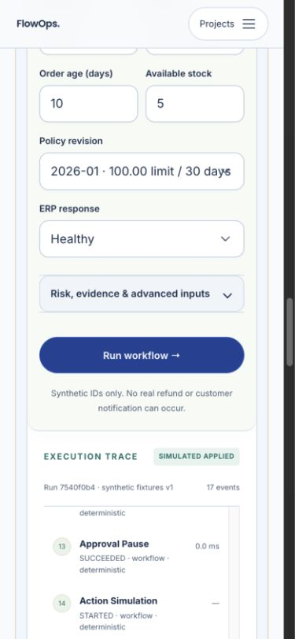

# FlowOps

An auditable order-resolution workflow. A supervisor coordinates research, policy, operations and risk review; deterministic checks control approvals and simulated actions.

Version **0.2.0**. The default application is a self-hostable deterministic demonstration with synthetic data. It executes real application code, makes no paid model calls and changes no customer systems. [Try the public demo](https://portfolio.gappazappa.in/projects/flowops).

## Run locally

Install [Docker Desktop or Docker Engine with the Compose plugin](https://docs.docker.com/get-started/get-docker/) and Git, then start the Docker engine. Also install Python 3.12+ for the configuration helper. Check that `docker info` and `docker compose version` succeed. Commands use a POSIX shell (macOS, Linux or WSL2 on Windows). If you use a named Docker context, pass `docker --context NAME compose ...` consistently. After cloning, run the remaining commands from the repository root.

```sh
git clone https://github.com/prasanthp01/flowops.git
cd flowops
python3 scripts/init_local.py
docker compose up --build -d --wait
```

Open **http://127.0.0.1:8765/projects/flowops**. The default stack publishes only a loopback port. Generated credentials are ignored by Git; keep them private. Retain both the database volume and `.local/secrets` to resume later. The helper can be rerun; it preserves existing credentials. See [troubleshooting](docs/TROUBLESHOOTING.md).



### Check and restart

```sh
docker compose ps
curl --fail --silent --show-error http://127.0.0.1:8765/api/projects/flowops/health
docker compose stop
docker compose up -d --wait
```

Readiness must return HTTP 200. For startup failures, inspect `docker compose logs --tail=80 api worker`. Reload the browser after restarting. Use `stop` to pause; `down` removes this Compose project's containers and network but retains its named volume. Do not use `down -v` when you want to keep your data.

For an occupied port or a second checkout, use a separate Compose project and matching port/origin:

```sh
FLOWOPS_HOST_PORT=8767 docker compose -p flowops-second up --build -d --wait
```

Open `http://127.0.0.1:8767/projects/flowops`. Keep the same environment overrides and `-p flowops-second` on subsequent Compose commands; otherwise you will address the default instance. [Compose project names](https://docs.docker.com/compose/how-tos/project-name/) isolate containers and volumes between checkouts.

## Try it

Choose **Eligible refund**: an 80.00 request on a 120.00 delivered order returns `SIMULATED_APPLIED`. Choose **ERP recovery** to see two failed connector attempts followed by one simulated receipt. **Approval required** pauses until an operator approves the exact proposal digest.

Change inputs, run again, inspect chronological server events, switch to the technical view and compare results. Recorded results are labelled separately from a new execution.

## How it works

FastAPI validates bounded inputs. PostgreSQL stores jobs, checkpoints, approvals and an ordered event log. A separate worker claims leased jobs and applies fenced writes. Specialist handoffs carry typed evidence; the authorization gate checks identity, money limits, policy revision and approval bindings before the fake action gateway records an idempotent receipt.

- [Architecture and tradeoffs](architecture.md)
- [API, request formats and examples](docs/API.md)
- [Operations, backup and recovery](operations/runbook.md)
- [Security boundaries and reporting](SECURITY.md)

## Scope and production deployment

The shipped connectors and actions are synthetic. No real refund, customer notification, enterprise connector or live-model call is enabled. The optional Contracts v1 entrypoint and peer clients are separate from the default browser API; see [API documentation](docs/API.md).

For an internet-facing deployment, follow [deployment requirements](docs/DEPLOYMENT_GUIDE.md): configured HTTPS origin, secure cookies, narrow ingress, isolated storage, resource limits, tested backups and monitored health. The default local command is not an internet-facing deployment. Production readiness applies to the documented synthetic scope; live inference and enterprise workloads require separate validation.

## Verify and contribute

Install [uv](https://docs.astral.sh/uv/getting-started/installation/) for source verification. The following commands select Python 3.12 and install the locked development dependencies. Run them from the repository root.

```sh
uv sync --frozen --python 3.12
uv run python scripts/init_local.py
docker compose -f compose.yaml -f compose.qa.yaml up --build -d --wait
uv run python scripts/dev.py .venv/bin/alembic upgrade head
uv run python scripts/dev.py .venv/bin/pytest -q
uv run ruff check flowops tests scripts operations migrations
uv run mypy flowops
```

The QA overlay publishes PostgreSQL on loopback port 55439. Confirm it is free before starting. The initializer creates a separate `flowops_test` database; `scripts/dev.py` loads its generated credentials without exposing them in the command line. Tests refuse the ordinary application database. Stop the QA stack with `docker compose -f compose.yaml -f compose.qa.yaml stop`. Never point tests, load tools or recovery drills at a live deployment. The [release report](docs/RELEASE_READINESS.md) records current test results and remaining limits. Hosted CI repeats the relevant checks on pushes and pull requests. See [CONTRIBUTING.md](CONTRIBUTING.md) for the test environment and review process.

## Performance and cost

Use `uv run python scripts/benchmark.py` in an isolated environment and record the revision, hardware, concurrency and duration. Synthetic provider costs and modeled latency are not invoices or live-provider measurements. Keyless runs have zero external model spend; hosting and CPU costs remain separate. No commercial-scale capacity or independent penetration-test claim is made.

## License

MIT for the original implementation. Bundled dependencies and assets retain their own licenses; see [third-party notices](NOTICE.md). No personal CV, portrait, deployment credentials or private customer data is included.
