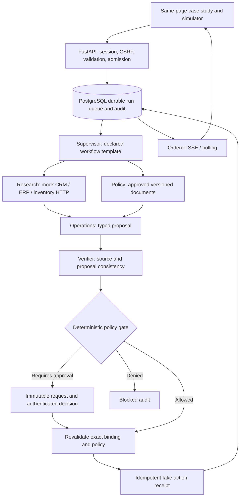

# FlowOps architecture

## Boundaries

The browser edits bounded synthetic fields and receives a signed, environment-bound, one-hour sandbox session. The API validates the request and commits a run row that is also its durable work marker. A worker claims an eligible row with `FOR UPDATE SKIP LOCKED`, increments its fencing version, releases the transaction, computes one bounded step, and commits only if its lease and claim are still valid.

The API and worker use a dedicated non-superuser runtime database role. A separate owner role runs migrations. Runtime permissions make event, approval, decision and fake-effect rows append-only; scheduled run retention can cascade-delete their complete run records. Database administrators remain trusted and can alter data. This is not a cryptographically tamper-proof ledger or tenant-isolation claim.

## Roles and contracts

`contracts.py` defines bounded inputs, typed handoffs, role outputs, proposals and approval decisions. `agents.py` executes real HTTP client requests against an in-process mock transport. Research and policy retrieval run concurrently; operations consumes the validated research output, and the verifier checks it against authorized source facts and the canonical policy revision. Each handoff contains run/task identity, specialist role, delegated scope, evidence references, output schema, deadline, environment, correlation ID and workflow version. `require_scope` checks both the delegated scope and the role's fixed capability set.

The supervisor selects a declared refund or inventory route. This is deterministic orchestration, not autonomous LLM reasoning. Four specialists are required on both paths; route and proposal differences affect gate, pause, simulated-action and blocked branches. The policy engine rechecks amounts/permissions independently of advisory outputs at the action boundary.

## State and business outcomes

| Lifecycle | Business outcome | Behavior |
| --- | --- | --- |
| `ACCEPTED` | `PROPOSED` | Durable admission; not yet claimed |
| `RUNNING` | `PROPOSED` | Bounded graph step / durable backoff |
| `RUNNING` | `APPROVAL_PENDING` | Checkpointed pause, no worker held; waits at most 10 minutes |
| `SUCCEEDED` | `SIMULATED_APPLIED` | Fake target-side receipt exists |
| `SUCCEEDED` | `BLOCKED` | Investigation completed with a policy denial/rejection |
| `FAILED` | `FAILED` or `BLOCKED` | Retry exhaustion, deadline or internal safe stop |
| `CANCELLED` / `EXPIRED` | `BLOCKED` or `FAILED` | Terminal; fencing version invalidates old workers |

Phases are validation → plan → parallel research/policy → operations proposal → risk review → authorization/approval → action simulation → audit. There is no recursion or unbounded fanout. Each claim is leased for 15 seconds; step execution times out within 5 seconds, below the lease window. A fencing-aware heartbeat primitive is tested for future longer adapters but is not needed for these bounded steps. Up to three attempts per phase use exponential backoff, seeded jitter and Retry-After. Runs have a 60-second processing deadline; approved resumption receives a fresh bounded deadline. Retention is one hour and expired data is periodically deleted.

Run ID + environment + workflow version + canonical proposal form the stable operation digest. Claims do not enter the digest. The fake gateway commits its own target receipt before an intentionally lost response; subsequent attempts reconcile that receipt. Exactly-once execution against real third-party systems is not claimed. Cancellation can stop future steps; it cannot erase an already committed fake receipt.

## Model and connector boundary

`ModelRuntime` and `InferenceRequest` preserve a provider-neutral integration boundary. `SafeRuntime` performs no paid call. Mock outage or invalid output yields `AI_UNAVAILABLE`, retains the verifier, and requests explicit human review. No cached direct-provider routing is enabled because distributed spend reservations and an external AgentOps contract are not verified. The supplied AgentOps request schema lacks a content field and response schema, so production envelope/endpoint compatibility must be agreed with that service before a real adapter is connected.

All connector destinations are fixed fake transport paths. There is no URL, SQL, shell, credential or free-text document input. Private connector implementations and outbound webhook delivery are deferred; there are no hidden live calls in the sandbox.

## Reproducibility and provenance

Same inputs, policy, fixture and workflow versions produce the same business outcome. UUIDs, wall-clock timestamps, durations, claim counters and operation receipts are intentionally run-specific. Audit events use a unique `(run_id, sequence)` constraint and sequence increments under the run row lock. Results carry mode, fixture/app/workflow/policy versions, connector identity and synthetic provenance. Observable facts and short decision rationales are recorded; private model reasoning is not.

Reference decisions: [ADR 001](docs/adr/001-boundaries.md). Framework references consulted: [FastAPI security](https://fastapi.tiangolo.com/tutorial/security/), [Pydantic strict validation](https://docs.pydantic.dev/latest/concepts/strict_mode/), [PostgreSQL SELECT locking](https://www.postgresql.org/docs/current/sql-select.html).
